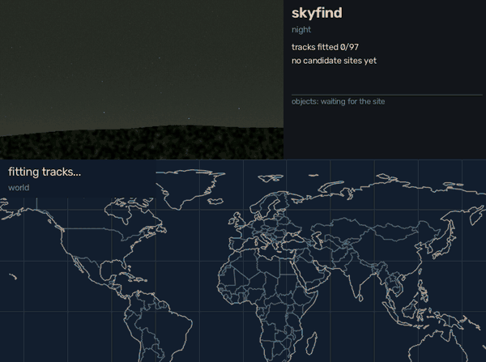
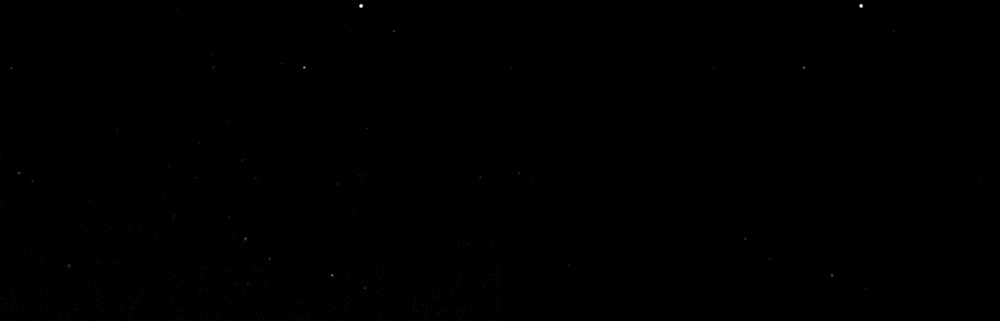
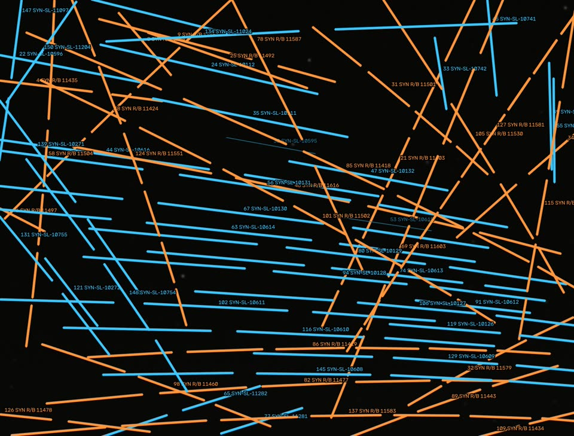

# skyfind

Finds where and when a night-sky timelapse was shot, and names the
satellites in it. From the footage alone: no GPS, no timestamps.



*A synthetic sky (made-up site, clock and constellation), `skyfind replay`.*

## How it works

1. **Stars** give the lens, where the camera points and the time between
   frames.
2. **The skyline** shows which way is up, which gives a rough latitude.
3. **Planets or comets** in view date the night.
4. **Satellite trails** are matched against the orbit of every catalogued
   object that night. The place and time where several different
   satellites line up is the answer: latitude, longitude, height, the
   clock and the exposure. Then every trail is named, with a confidence
   level and an estimate of how many matches are chance.

To find the trails, skyfind takes them out of a copy of the clip and
compares the two:



## Install

Needs [uv](https://docs.astral.sh/uv/) and ffmpeg.

```sh
uv sync
```

Or Docker: copy `.env.example` to `.env`, set your folders, then
`docker compose build`.

## Use

```sh
uv run skyfind run night.mp4 --tle night.3le   # trails, solve, report
uv run skyfind replay night.mp4                # GIF of the solve (--mp4 too)
uv run skyfind gui                             # workbench: uv sync --extra gui
```

In Docker: `docker compose run --rm skyfind run /clips/night.mp4 --tle /clips/night.3le`.

Results land in `night.skyfind/`: `solution.json`, the named trails
(`night_satellites*.jpg`, `.json`) and a site map.



**Orbital elements.** `--tle FILE` (2- or 3-line TLEs, e.g. a Space-Track
`gp_history` query), or set `SPACETRACK_USER` and `SPACETRACK_PASSWORD`
and skyfind downloads them. Elements over 30 days from the night are
ignored.

**No planets in view.**
- `--around "2024-10-02 06:00"`: rough UTC of the first frame (it still
  searches 12 h either side).
- `skyfind scan CLIP --from 2025-03-01 --to 2025-03-31`: each night in turn.
- `skyfind moon CLIP`: the nights a Moon in view fits.

**Other options.**
- `--free-site`: ignore a misleading skyline.
- `--interval SECONDS`: a tracking mount's frame interval (else searched,
  about 10 min).
- `--recorded JSON`: a clip the phone app recorded, with its GPS fix and
  times.

## Speed

NVIDIA GPU through CuPy (`uv pip install cupy-cuda13x`; `SKYFIND_GPU=0`
turns it off). On an RTX 3070 and an i9-14900K, a 4K clip with 130 tracks
against 27,000 objects solves in about 12 s; taking its trails out takes
about 40 s.

## Accuracy

Synthetic sky, blind over 12 h either side: site to about 0.001°, clock to
0.01 s, exposure to 0.02 s. Tripod, motion-control rig and tracking mount
(`tests/`).

## Data

Star catalogue, ephemeris, map layers and comet orbits download on first
use into `$SKYFIND_DATA`.

## Android

`android/` runs the same pipeline on a phone, and records clips itself,
focusing on the stars. See [android/README.md](android/README.md).

## With Claude

**Claude Code:** clone the repo and run `claude` in it. It reads
[CLAUDE.md](CLAUDE.md) on its own: the design, the invariants the tests
lock, the layout. Then ask it to run a solve, explain a result or change
the code.

**Claude.ai, or any other assistant:** paste this in first:

```text
skyfind: a Python CLI (uv or Docker) that finds where and when a night-sky
timelapse was shot and names its satellites, blind (no GPS, timestamps or
file-name hints). Stars give the lens, pointing and frame interval; the
skyline gives up; planets date the night; satellite trails fitted against
orbital elements give the site, clock and exposure, then a name per trail.

Needs: a night-sky timelapse (tripod, motion-control rig or tracking
mount) with satellite trails over several frames (aircraft don't count);
elements for the night via --tle FILE or the user's own Space-Track
account in SPACETRACK_USER / SPACETRACK_PASSWORD (never invent
credentials); a date from planets in view, else --around "YYYY-MM-DD
HH:MM" (UTC) or `skyfind scan CLIP --from DATE --to DATE`.

Commands: run (trails + solve + report), trails, solve, report, replay,
scan, moon, gui. Solve options: --free-site (misleading skyline),
--interval SECONDS (tracking mount), --recorded JSON (phone recording).

Output, in <stem>.skyfind/ beside the clip: solution.json with lat, lon,
height_km, sig_lat, sig_lon, sig_height_km (1 sigma), frame0_utc
(mid-exposure of frame 0), E (exposure s), spf (s between frames),
objects (name, norad, frames, err deg, conf confirmed/probable), ids (per
segment), null_rate (matches with the clock 5 and 10 min wrong: chance).

Errors: "no satellite trails to solve with": too few trails over 3+
frames. "no site stands out": wrong night, elements that don't cover it,
or trails that aren't satellites. Missing elements: the message prints
the Space-Track query.
```
